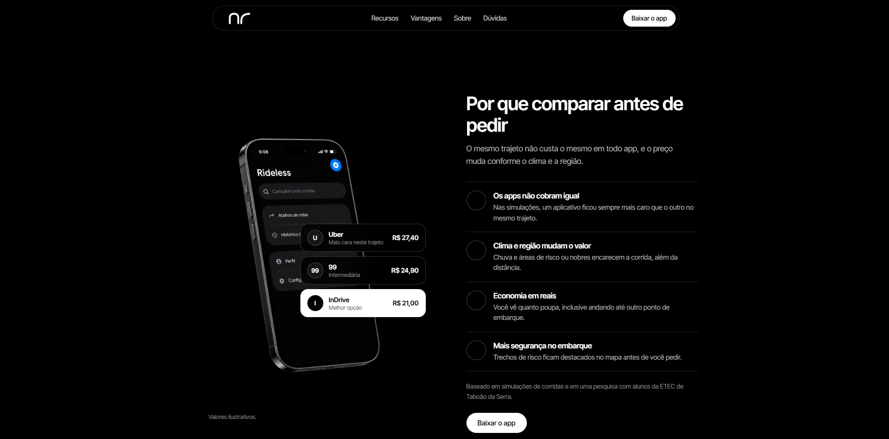

  

 

  

  Economize mais. Escolha melhor.

# Rideless

### Projeto Interdisciplinar

Uma proposta de solução digital que ajuda os usuários a comparar preços de deslocamento, considerando distância, economia e áreas de risco.

O **Rideless** busca facilitar a escolha de trajetos, mostrando como pequenas mudanças no percurso podem gerar economia e contribuir para deslocamentos mais conscientes.

  <a href="#">
    <strong>Acessar a Landing Page do Rideless</strong>
  </a>

## Sobre

O Rideless apresenta uma proposta de comparação de preços e trajetos por meio de:

* Comparação de preços
* Estimativa de economia
* Consideração de áreas de risco
* Análise de distância percorrida
* Interface simples e intuitiva

A proposta é ajudar o usuário a encontrar alternativas mais econômicas, considerando também a segurança durante o deslocamento.

## Tecnologias

  
  &nbsp;&nbsp;&nbsp;
  
  &nbsp;&nbsp;&nbsp;
  

  HTML5 &nbsp;·&nbsp; CSS3 &nbsp;·&nbsp; JavaScript

## Objetivo

Desenvolver uma solução digital que facilite a comparação de preços e ajude os usuários a identificar oportunidades de economia, levando em consideração a distância e as áreas de risco.

## Equipe

**Agno S.**,  
**Bruno G.**,  
**Heloísa M.** e  
**Gustavo M.**
